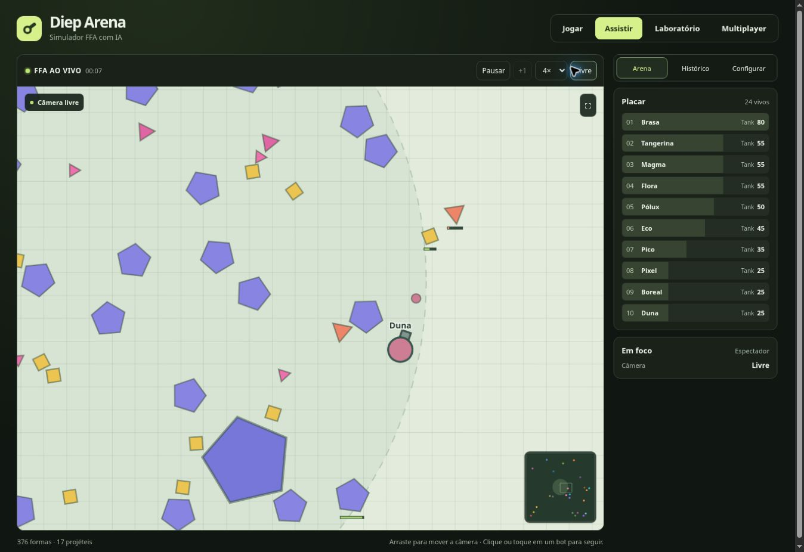
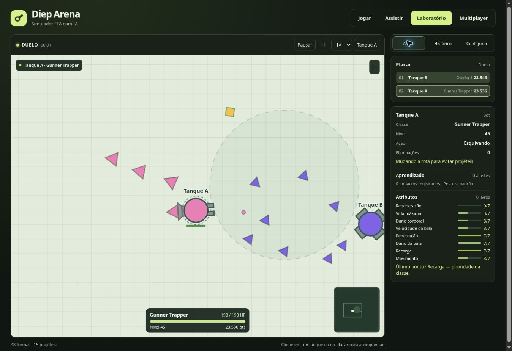

# Diep Arena

Diep Arena é um simulador de batalhas de tanques inspirado em Diep.io. Você pode acompanhar partidas entre bots, evoluir seu próprio tanque ou criar uma sala para jogar com um amigo. O jogo roda no navegador, no PC e no celular.

**[Jogar Diep Arena](https://ryanzin3331.github.io/diep-arena/)**

## Modos de jogo

| Modo | O que dá pra fazer |
| --- | --- |
| **Assistir** | Siga um bot pelo placar, veja o líder, acompanhe a ação ou use a câmera livre. Dá para pausar, acelerar e rever destaques no histórico. |
| **Jogar** | Comece no nível 1, destrua formas para ganhar XP, distribua pontos entre oito atributos e escolha sua classe conforme avança. |
| **Laboratório** | Escolha as classes dos bots e monte um duelo ou um desafio contra um chefe para testar como eles se enfrentam. |
| **Multiplayer** | Crie uma sala com código para dois jogadores, com 0, 4 ou 8 bots na arena aberta. |

Em **Configurar**, escolha o cenário da próxima partida. Além do FFA aberto, há **2 Teams, 4 Teams, Dominação, Mothership, Tag, Survival, Comboio e Maze**. O Maze tem uma versão fixa e outra gerada por seed. Os bots escolhem rotas de evolução e podem ajustar seus atributos e táticas durante a simulação.

## Jogar com um amigo

1. Os dois abrem o jogo no navegador.
2. Quem vai hospedar toca em **Multiplayer**, escolhe o número de bots e cria a sala.
3. O convidado digita o código em **Multiplayer → Entrar**. A partida começa quando ele entra.

A opção **Reiniciar ao morrer** define como a rodada funciona. Ligada, a morte de qualquer jogador encerra a rodada e os dois recomeçam no nível 1 após quatro segundos. Desligada, a arena continua e cada eliminação entre os dois jogadores vale um ponto no placar da sala. Quem caiu pode renascer.

## Classes

Consulte o [guia de classes](docs/CLASSES.md) para ver os níveis, as rotas de evolução e como testar o Hunter localmente.

## Controles

| Ação | PC | Celular |
| --- | --- | --- |
| Mover | WASD ou setas | Arraste no lado esquerdo da arena |
| Mirar e atirar | Mouse para mirar, clique esquerdo ou Espaço para atirar | Arraste no lado direito |
| Tiro automático | E | **Auto** |
| Ação secundária da classe | Shift ou clique direito | **Secundário**, quando disponível |
| Gastar pontos | Teclas 1–8 ou painel de melhorias | **Melhorias** |

Em tela cheia, toque em **Top 10** para abrir ou recolher o placar. No celular, dá para fazer isso com outro dedo enquanto continua movendo ou mirando.

## Rodar a partir do código

Abra [`index.html`](index.html) em um navegador ou sirva a pasta do projeto como um site estático. O jogo e o simulador estão em um único arquivo HTML com JavaScript e Canvas 2D. O multiplayer carrega o PeerJS e precisa de conexão de rede.

Projeto de **Ryanzin3331**, desenvolvido com auxílio de IA.
