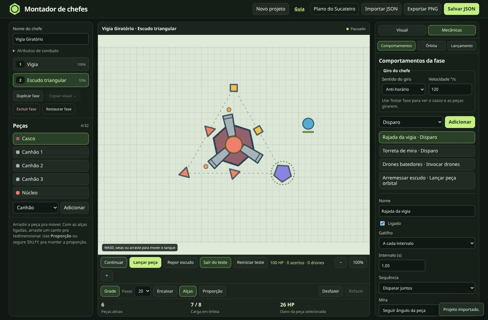
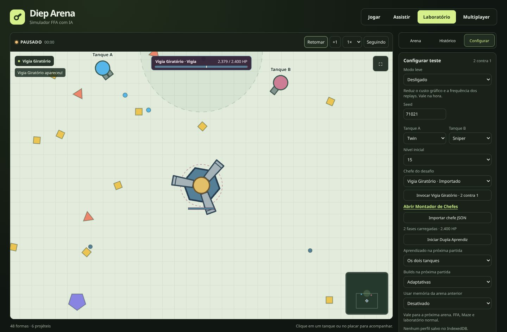

# Montador de Chefes do Diep Arena

Crie o casco de um chefe, configure os ataques de cada fase e importe o projeto no Laboratório para ver seu chefe enfrentar dois bots.

**[Abrir o Montador de Chefes](https://ryanzin3331.github.io/diep-arena/montador-de-chefes.html)** · **[Abrir o Diep Arena](https://ryanzin3331.github.io/diep-arena/)** · **[Vigia Giratório em JSON](exemplos/vigia-giratorio.json)**

## Monte a primeira fase

1. Clique em **Novo projeto** e escolha um chefe em branco ou o modelo do Sucateiro.
2. Defina **Vida máxima**, **Dano de contato** e **Raio de colisão** em **Atributos de combate**. Com raio 0, a colisão usa o raio visual do casco de cada fase.
3. Adicione canhões, blindagens, núcleos ou polígonos. Arraste as peças na grade ou use os números de posição, tamanho e rotação. **Encaixar** prende o movimento à grade, e **Alças** mostra os cantos usados para redimensionar.
4. Para usar uma peça como origem de ataque, selecione-a no painel **Visual**, clique em **Posicionar na arena** em **Origem de emissão** e marque o ponto na prévia. Um canhão sem ponto personalizado dispara pela boca.
5. Adicione fases e configure o percentual de HP em que cada uma começa. As fases podem ter peças, cores e comportamentos próprios.

## Configure os ataques

Abra **Mecânicas → Comportamentos**. Cada comportamento pode executar em intervalos, ao entrar na fase ou quando um alvo chegar ao alcance.

| Recurso | O que dá para montar |
| --- | --- |
| **Giro do chefe** | Escolha parado, horário ou anti-horário por fase. O giro vai de 1 a 360°/s. A 60°/s, uma volta leva 6 segundos. |
| **Disparo** | Escolha os emissores, dispare alternando ou em conjunto e ajuste dano, velocidade e mira. Um canhão fixo acompanha o giro do casco. Um canhão com mira contínua pode acompanhar o alvo enquanto o casco gira. |
| **Drones** | Escolha origem, quantidade, limite simultâneo, dano, velocidade e tempo de vida. Eles podem orbitar ou perseguir. Em **Modelar drone**, combine formas ou desenhe um polígono ponto a ponto. |
| **Movimento** | Faça o chefe patrulhar em círculo, manter distância ou investir. Ajuste velocidade, distância e duração. |
| **Escudo orbital** | Ative e escolha um trajeto circular, triangular ou desenhado por você. Defina raio, velocidade, capacidade, quantidade e tamanho das peças. O escudo tem o próprio giro, independente do casco. |
| **Lançar peça orbital** | Mire no alvo ou use um ângulo fixo. Ajuste dano, velocidade, aviso e recarga. No Laboratório, os tanques podem destruir a peça antes do lançamento. |

Use **Testar fase** para ver o giro e os ataques. No celular, toque ou arraste o tanque de teste pela prévia. No computador, você também pode movê-lo com **WASD** ou as setas. Ao sair do teste, o Montador volta à posição de edição. No Laboratório, se a fase seguinte estiver em **Parado**, o casco mantém o ângulo que atingiu na fase anterior.

## Teste no jogo

1. Clique em **Salvar JSON** no Montador.
2. No Diep Arena, vá em **Laboratório → Configurar → Importar chefe JSON** e selecione o arquivo.
3. Escolha os dois tanques e o nível e clique em **Invocar**. O jogo mostra as fases na barra de HP.
4. Para editar de novo, use **Importar JSON** no Montador. **Exportar PNG** baixa uma imagem da fase com fundo transparente.

### Experimente no celular

Baixe o [JSON do Vigia Giratório](https://ryanzin3331.github.io/diep-arena/docs/exemplos/vigia-giratorio.json) ou use **Download raw file** no [arquivo do GitHub](exemplos/vigia-giratorio.json). Importe no Montador para editar ou diretamente no Laboratório para jogar. O Vigia gira a 60°/s na primeira fase. A 55% de HP, muda o sentido, acelera para 120°/s, ganha um escudo triangular e começa a invocar drones.

O Montador salva o projeto atual no navegador. Guarde o JSON para transferir o chefe para outro aparelho ou manter uma cópia. O importador aceita projetos do Montador das versões 1 a 9, com até 8 fases. Chefes importados ficam no seletor do Laboratório durante a sessão.
